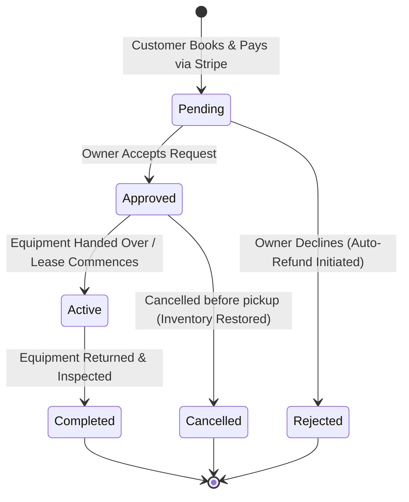

<div align="center">

# 🛠️ EquipHub Backend API Engine

**High-Performance Enterprise Equipment Rental Platform Backend**

[](https://nodejs.org/)
[](https://expressjs.com/)
[](https://www.mongodb.com/atlas)
[](https://stripe.com/)
[](https://cpanel.net/)
[](https://github.com/abdullahalnoman-3/EquipHub_backend)

<br/>

**Production API URL:** [https://equiphubadmin.hmnoman.com/api/v1](https://equiphubadmin.hmnoman.com/api/v1)  
**Production Health Check:** [https://equiphubadmin.hmnoman.com/health](https://equiphubadmin.hmnoman.com/health)  
**Live Frontend Web App:** [https://equiphub.hmnoman.com](https://equiphub.hmnoman.com)

</div>

---

## 📖 Overview

**EquipHub Backend API** is the core engine powering the **EquipHub Smart Equipment Rental Platform**. It provides robust, secure, and production-grade RESTful APIs for equipment listing management, booking workflows, Stripe checkout integration, user role-based access control (RBAC), real-time rental tracking, email notifications, and dynamic administrative control.

Built specifically for high availability on both cloud containers and standard Linux cPanel hosting environments (CloudLinux / LiteSpeed / Phusion Passenger).

---

## ⚡ Core Technical Highlights

* **Architecture:** Modular MVC architecture with controllers, middleware, models, routes, and centralized configuration.
* **Database Driver:** Native MongoDB driver utilizing flexible schema models and indexed document collections.
* **Authentication & RBAC:** JWT (JSON Web Token) with bcrypt password hashing, session tokens, and middleware enforcement (`verifyToken`, `verifyAdmin`, `verifyOwner`).
* **Automated Cron Engine:** Embedded `node-cron` worker that periodically checks rental transition timestamps (e.g. marking overdue or completed rentals automatically).
* **Multi-Platform Image Pipeline:** Built-in Multer storage with Sharp image processing and automatic Linux x64 fallback wrappers for shared hosting.
* **Security & CORS:** Helmet security headers, rate limiting, and dynamic multi-origin CORS whitelist supporting `https://equiphub.hmnoman.com`, `http://equiphub.hmnoman.com`, and localhost environments.

---

## 🎛️ Dynamic Admin Credential & Settings Management

One of the standout features of EquipHub is that **the administrator can add, edit, test, and manage all core third-party credentials directly from the Admin Dashboard** without touching any `.env` file or restarting the production server:

```
┌────────────────────────────────────────────────────────────────────────┐
│                      ADMIN DASHBOARD SETTINGS                          │
├──────────────────────────┬─────────────────────────────┬───────────────┤
│ Module                   │ Configurable Credentials    │ Live Test API │
├──────────────────────────┼─────────────────────────────┼───────────────┤
│ 📧 SMTP Email Gateway    │ Host, Port, User, Password, │ Direct Test   │
│                          │ Secure SSL/TLS, From Email  │ Email Trigger │
├──────────────────────────┼─────────────────────────────┼───────────────┤
│ 💳 Payment Gateway       │ Stripe Secret Key, Mode     │ Ping Gateway  │
│                          │ (Test/Live), Currency, Web- │ Verification  │
│                          │ hook Secret, Fee Percentage │ Endpoint      │
├──────────────────────────┼─────────────────────────────┼───────────────┤
│ 🔑 Social Login Apps     │ Google OAuth Client ID &    │ Instant Save  │
│                          │ Secret, GitHub OAuth Client │ & Dynamic     │
│                          │ ID & Secret                 │ Resolution    │
└──────────────────────────┴─────────────────────────────┴───────────────┘
```

### 1. SMTP Email Server Configuration (`/api/v1/admin/smtp`)
- Admin can configure custom SMTP servers (Gmail, SendGrid, Mailgun, Amazon SES, or custom cPanel Webmail).
- Supports dynamic fallback: If database settings are not yet set, the engine falls back to environment variables seamlessly.
- Used for automated booking confirmation emails, approval notices, payment receipts, and owner alerts.

### 2. Payment Gateway Configuration (`/api/v1/admin/payment-settings`)
- Admin can update Stripe Secret Key, switch between `test` and `live` modes, and customize transaction fees on the fly.
- Includes a dedicated test endpoint (`POST /api/v1/admin/payment-settings/test`) that verifies API key validity directly against Stripe servers.

### 3. Social Login OAuth App Credentials (`/api/v1/admin/social-settings`)
- Admin can register and edit Google OAuth 2.0 and GitHub OAuth application credentials directly.
- Frontend authentication dialog reads these settings dynamically to initiate secure OAuth consent screens.

---

## 🔄 Dual-Gate Rental State Machine

The rental order lifecycle enforces strict business rules to prevent inventory conflicts and unauthorized cancellations:



* **`Pending`**: Default status upon successful payment. Equipment dates reserved.
* **`Approved`**: Owner accepts reservation. Both parties can communicate and prepare pickup.
* **`Active`**: Rental active. **Strict Rule:** Active rentals cannot be cancelled or rejected.
* **`Completed`**: Gear returned in good condition. Customer can now leave a verified review.
* **`Cancelled / Rejected`**: Automatically frees up the calendar dates and transfers payment to the refund pipeline.

---

## 📡 API Reference Overview

All endpoints are prefixed with `/api/v1`.

### Authentication (`/auth`)
| Method | Endpoint | Description | Access |
|---|---|---|---|
| `POST` | `/auth/register` | Register new account with role (`customer` / `owner`) | Public |
| `POST` | `/auth/login` | Login with email and password | Public |
| `POST` | `/auth/social-login` | Authenticate or register via Google/GitHub OAuth | Public |
| `GET` | `/auth/me` | Fetch authenticated user profile & roles | Private |

### Equipment Catalog (`/equipment`)
| Method | Endpoint | Description | Access |
|---|---|---|---|
| `GET` | `/equipment` | List equipment with search, category, & date filters | Public |
| `GET` | `/equipment/:id` | Fetch detailed single equipment listing | Public |
| `POST` | `/equipment` | Create new equipment listing with images & pricing | Owner / Admin |
| `PUT` | `/equipment/:id` | Update equipment specs, pricing, and availability | Owner / Admin |
| `DELETE`| `/equipment/:id` | Remove equipment listing | Owner / Admin |

### Bookings & Rentals (`/bookings`)
| Method | Endpoint | Description | Access |
|---|---|---|---|
| `POST` | `/bookings` | Create rental booking request | Authenticated |
| `GET` | `/bookings/my-rentals` | List user's rental history & active orders | Customer |
| `GET` | `/bookings/owner-rentals`| List rental requests for owner's items | Owner |
| `PATCH`| `/bookings/:id/status` | Update booking status (`Approved`, `Active`, etc.) | Owner / Admin |

### Payments (`/payments`)
| Method | Endpoint | Description | Access |
|---|---|---|---|
| `POST` | `/payments/create-checkout` | Initialize Stripe Checkout session | Authenticated |
| `POST` | `/payments/verify` | Verify payment status and confirm booking | Authenticated |

### Admin Control & Settings (`/admin`)
| Method | Endpoint | Description | Access |
|---|---|---|---|
| `GET` | `/admin/equipment` | View all platform equipment with moderation flags | Admin Only |
| `PATCH`| `/admin/equipment/:id/status`| Approve, reject, or suspend equipment | Admin Only |
| `GET` | `/admin/rentals` | Platform-wide rental ledger & dispute log | Admin Only |
| `GET` | `/admin/reviews` | Review moderation feed | Admin Only |
| `GET` | `/admin/smtp` | Retrieve current SMTP configuration | Admin Only |
| `PATCH`| `/admin/smtp` | Update SMTP email host, credentials, & sender | Admin Only |
| `GET` | `/admin/payment-settings` | Retrieve active Payment Gateway configuration | Admin Only |
| `PATCH`| `/admin/payment-settings` | Update Stripe secret keys, mode, & fees | Admin Only |
| `POST` | `/admin/payment-settings/test` | Live test ping against Stripe servers | Admin Only |
| `GET` | `/admin/social-settings` | Retrieve Google/GitHub OAuth settings | Admin Only |
| `PATCH`| `/admin/social-settings` | Update Social Login Client IDs and Secrets | Admin Only |

---

## 🚀 Local Development Setup

### 1. Clone the repository
```bash
git clone https://github.com/abdullahalnoman-3/EquipHub_backend.git
cd EquipHub_backend
```

### 2. Install dependencies
```bash
npm install
```

### 3. Configure environment variables
Create a `.env` file in the root directory (based on `.env.example`):
```env
PORT=5000
NODE_ENV=development
DB_USER=your_db_username
DB_PASS=your_db_password
DB_NAME=equiphub_db
DB_URI=mongodb+srv://<username>:<password>@cluster0.2ssk8l9.mongodb.net/equiphub_db?retryWrites=true&w=majority
JWT_SECRET=your_jwt_secret_key_here
CLIENT_URL=http://localhost:3000
STRIPE_SECRET_KEY=sk_test_your_stripe_secret_key
```

### 4. Run the server
```bash
# Development mode with auto-reload
npm run dev

# Or standard production mode
npm start
```
The server will start on `http://localhost:5000`.

---

## 🌐 cPanel Production Deployment Guide

1. **cPanel Node.js App Setup:**
   * Go to **Software** > **Setup Node.js App** in cPanel.
   * Click **Create Application**:
     * **Node.js Version:** `20.x` or `22.x`
     * **Application Mode:** `Production`
     * **Application Root:** `equiphubadmin.hmnoman.com`
     * **Application URL:** `equiphubadmin.hmnoman.com`
     * **Application Startup File:** `app.js` (or `index.js`)
2. **Deploy Files:**
   * Upload all backend files (excluding `node_modules` and local `.env`).
   * Create or paste production `.env` variables via cPanel UI.
3. **Install Dependencies:**
   * Click **Run NPM Install** in cPanel Node.js App manager.
4. **Restart Application:**
   * Click **Restart**.
   * Verify by browsing to `https://equiphubadmin.hmnoman.com/health`.

---

## 📄 License

This project is licensed under the [MIT License](LICENSE).
EquipHub Platform © 2026. All rights reserved.
